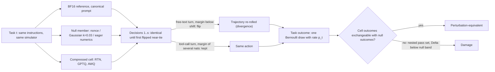

<!--
TL;DR (draft status, 2026-09-28): first full draft of the COLING 2026 long paper, following paper/.plans/perturbation-equivalence-closed-loop.md; every number traces to paper/perturbation-equivalence-closed-loop.provenance.md.
Evidence status: I4a (serving numerics move the canonical score) and the 4B deep dive are stated as findings; the divergence floor (I1 v2) is stated for q4 (clean) and q8 (legacy + partial clean); the free zone (I2) is tentative on q4; D-sufficiency (I3) is an open question.
All five-model curves, success-vs-δ null bands, E3 open-loop D beyond the q4 pilot, and clean re-tests of I2/I3 are marked [PENDING: ...] and written so they can be filled either way.
-->

# Perturbation Equivalence in Closed-Loop Agents: When Is a Compressed Agent Actually Worse?

*Anonymous COLING 2026 submission — first full draft*

## Abstract

Compressed LLM agents are usually judged against a single run of the full-precision model. We argue that in closed-loop evaluation this comparison is ill-posed. Composing a published per-step margin model of greedy token flips over the decisions of an episode, we show that any perturbation that moves logits by at least the bf16 log-probability resolution meets a per-decision divergence floor set by near-ties in free-text turns, so the trajectory is re-rolled whether the perturbation is a prompt nonce, a compiler kernel choice, or weight quantization. We therefore propose *perturbation equivalence*: a compressed agent is judged by task-level exchangeability with outcomes drawn from the reference model's own perturbation null. On τ²-bench retail and airline (85 tasks) with Qwen3 agents, changing serving numerics alone moves the canonical score by 6–8 points and flips about a quarter of task outcomes, and a single-draw 12-point calibration gain on a 4B agent reverses sign on replication. On Qwen3-4B, success stays at null level through Gaussian weight noise at the RTN-W4 error scale and drops only near 3-bit, a tentative later damage threshold. [PENDING: five-model summary sentence — cells a6k2_{q4,q8,q14,q30a3,q32}_*, scripts analysis/insights/iter_1/verify/v01_legacy_recompute.py a6k2, v03_outcomes_pooled.py a6k2, v04_pooled_draws.py] We close with an evaluator checklist.

## 1 Introduction

Agent benchmarks such as τ²-bench [1] score a model by letting it interact with a simulated user and a tool environment until the episode ends, and then checking the final database state. When a compressed model is evaluated this way, the usual report is a pair of numbers: the score of the BF16 reference and the score of the compressed model, each from one run. This paper asks what such a pair can tell us.

Our own project supplies the first warning. In an early study of calibration data for 4-bit GPTQ on Qwen3-4B, a trajectory-based calibration arm (FP-Traj) beat a static calibration arm by +0.121 in database match on the 58 retail tasks (8 tasks won by FP-Traj alone, 1 by Static alone; exact one-sided McNemar p = 0.0195). The pre-registered replication with three independent calibration draws gave −0.035 pooled (−0.045 on long tasks), with the sign reversed and both intervals spanning zero. The original result was one draw of a noisy process.

The second warning is sharper, because it involves no change to the model at all. When we re-served the same BF16 weights with the same prompt under a different floating-point configuration of the serving stack (for both the agent and the user simulator), the canonical score of Qwen3-4B moved from 0.412 to 0.329, and that of Qwen3-8B from 0.316 to 0.380; 21 of 85 and 21 of 79 task outcomes changed. A compressed model compared against either of these reference runs would receive a different verdict.

We explain both observations with one mechanism. Greedy decoding picks the top token at every position. When the top two candidates are nearly tied, any perturbation of the logits that exceeds the gap can flip the choice. This per-step account is established: Du et al. (2026) state it for BF16-versus-FP16 decoding [2], and kernel-level studies report that the top-two margin predicts which tokens flip [3, 4]. In a closed-loop agent, a flipped token changes the context of every later turn, including the simulated user's replies, so a single flip re-rolls the rest of the trajectory. Free-text turns contain many near-ties, so a perturbation of almost any size re-rolls almost every episode. The outcome of each task is then better described as one Bernoulli draw than as a fixed property of the model.

If this is right, the question "is the compressed agent worse?" must be answered against the distribution of outcomes that the reference model itself produces under perturbations that carry no capability change: prompt nonces, tiny weight noise, and serving-numerics changes. We make three contributions.

1. **A criterion.** We define *perturbation equivalence*: a compressed agent is equivalent to its reference if its task-level outcomes are exchangeable with those of a null family built from the reference model's own sub-threshold perturbations. We show that the canonical reference score is one draw from this family (serving numerics alone flip about a quarter of task outcomes; null-draw standard deviations match the Bernoulli prediction), which is why a reference-only comparison can produce false positives such as the one above.
2. **A closed-loop composition of the per-step margin model, with two measured regimes.** Composing the inherited per-step model over an episode predicts (P1) a per-decision divergence *floor* that every perturbation above the bf16 log-probability resolution reaches, followed by a regime where the per-decision hazard ranks perturbation size; (P2) a *damage* threshold that lies later than the divergence threshold, leaving a zone where trajectories are fully re-rolled but success stays at null level; and (P3) that the divergence curve is predictable from the reference model's margin distribution. P1 holds on Qwen3-4B on clean data and is consistent on Qwen3-8B; P2 is a tentative finding on Qwen3-4B; P3 is partly supported and partly at risk.
3. **A serving-numerics finding and a deterministic serving recipe.** A compile-time autotuning choice in the fused residual + RMSNorm kernel changed the summation order across nodes, shifted all 113 identical-prompt decisions of a determinism pair (non-zero shifts on 59% of tokens), and re-rolled about 95% of its trajectories (Kaplan–Meier estimate over 20 tasks). We describe the fix (deterministic Inductor configuration plus a numerics canary) and verify cross-node byte-identity (257/257 and 303/303 decisions).

We also report consequences on a 4B deep dive: 18 GPTQ checkpoints from six calibration strategies are statistically indistinguishable in closed loop, and open-loop teacher-forced NLL is unrelated to closed-loop success.

## 2 Related Work

**Compressed LLMs as agents.** ACBench (Dong et al., 2025) evaluates 15 compressed models (GPTQ, AWQ, SmoothQuant, SparseGPT, Wanda) on workflow, tool-use, long-context and application tasks; workflow generation and tool use drop 1–3% at 4 bits while real-world application tasks drop 10–15% [5]. It sets temperature 0 [5]; our notes record one run per configuration and no reported variance. The closest work to ours is *Flat Score, Amplified Failures* (Jang et al., 2026), which evaluates BF16, FP8 and AWQ-INT4 agents on τ²-bench retail and telecom with four trials per task [6]. It finds no score change that survives multiple-comparison correction, reports TOST equivalence at a ±7.5-point margin, estimates its run-to-run noise floor (about 1.5 points) from a single repeat run, and shows that failure modes such as tool-name hallucination rise up to 2.5× while the aggregate stays flat; shrinking the error budget to two errors re-exposes a 17-point gap [6]. It gives a verbal margin account of why quantization flips thin-margin decisions, but notes that token log-probabilities are not in its logs [6], and it measures neither divergence nor a perturbation null. We share its benchmark and its concern; we add measured margins, a perturbation null, and a divergence model. Other recent work reports token inflation under low-bit quantization (Lian et al., 2026) [7], task-dependent precision needs of quantized agents (Mix-Quant [8]; QuantClaw [9]), and function calling that stays robust under aggressive quantization (IFFC; Taheri et al., 2026) [10]. Closed-loop quantization studies outside NLP, such as VLAQuantBench (Xu et al., 2026), evaluate post-training quantization of vision-language-action policies in closed-loop simulation [11].

**Evaluation noise and reference nulls.** Signal and Noise (Heineman et al., 2025) formalizes the separability of benchmarks [12]; AI Agents That Matter (Kapoor et al., 2024) criticizes agent benchmarking practice [13]; τ-bench (Yao et al., 2024) introduced pass^k to quantify reliability over repeated trials [14]. On τ²-bench specifically, an analysis of released trajectories estimates that single runs must differ by 7–8 points (retail) or 10–11 points (airline) to exceed noise under sampling, including the user simulator's sampling [15], and Bjarnason et al. (2026) find that single-run pass@1 on SWE-bench Verified agents varies by 2.2–6.0 points depending on the run, with standard deviations above 1.5 points even at temperature 0 [16]. The Noise Floor Audit (Chen et al., 2026) finds on single-turn BFCL that prompt perturbations produce paired standard deviations 11–58× those of reruns, and it excludes multi-turn agent trajectories from its scope [17]. Singh (2026) audits equivalence claims for compressed models on static benchmarks, finds that per-item churn is about 5× the net delta, and proposes paired equivalence testing at a *declared* margin (±2 points in its worked example) [18]. The Replay Gap (Gonuguntla, 2026) uses same-model control forks as a null for model switching in SWE agents and finds that FP8-served control forks diverge in over 90% of cases while AWQ-served controls remain near-identical [19], so the width of a rerun null depends on the serving format. Statistical precedents for a perturbation-derived null include a composite null of semantically irrelevant query perturbations (Acharyya et al., 2025) [20], data-dependent equivalence margins (Koobs and Koning, 2026) [21], and counterfactual-prompting baselines (Yang et al., 2026) [22]. Our criterion differs from these in taking the null from the reference model's *own* perturbation distribution, task by task, in a closed-loop agent, and in explaining its width with a margin model.

**The per-step margin model (inherited).** Du et al. (2026) show that BF16 and FP16 greedy decoding diverge on 49–100% of prompts and that a token flips when the perturbation of the logit gap exceeds the top-two margin, with the heuristic $P(\text{flip at } t) \lesssim P(\Delta_t < \sigma_z)$ (their Eq. 14) [2]. The Integer Alibi (Chen, 2026) reports the same relation for INT8 kernel swaps, with a margin-to-flip ROC-AUC of 0.942 [3], and MarginGate (Chu et al., 2026) exploits low top-two margins to restore determinism under batching [4]. Yuan et al. (2025) [23] and the Thinking Machines report on batch-invariant kernels (He, 2025) [24] document numerical nondeterminism in serving. We take the per-step model as given. Our contribution is its composition over a closed loop, the resulting floor and two-regime structure along a single perturbation axis, the later damage threshold, and the use of the model to define and interpret a null.

**Divergence in multi-turn and agent settings.** Patodiya (2026) reports that prefix caching changes 36.2% of multi-turn tool episodes at 16 bits and 75.0% at 4 bits, and that amplification saturates at the coarsest settings; it contrasts a 3.5% divergence rate on a single-turn bridge with 36.2% per episode and explains the gap by compounding, stated in words [25]. AgentDiff (Zhang and Guo, 2026) finds that meaning-bearing rewrites destabilize agents more than presentation changes [26]; our nonce is a presentation change. Lost in Multi-Turn (Laban et al., 2025) attributes most multi-turn loss to unreliability rather than aptitude [27], and Sinha et al. (2026) study long-horizon execution [28]. Classical work on compounding error in sequential prediction (DAgger [29]; scheduled sampling [30]) motivates the closed-loop view.

**Open-loop versus closed-loop fidelity.** Flip and token-divergence metrics show that equal accuracy can hide changed predictions (Dutta et al., 2024 [31]; Deiseroth et al., 2023 [32]), and distribution-divergence metrics have been proposed as a complement to accuracy (Qamar et al., 2026) [33]. In driving, open-loop metrics correlate with closed-loop scores only non-monotonically, with ranking inversions (Wang et al., 2026) [34]. We add a direct measurement for quantized tool agents (§5.4).

**Table 2.** Comparison with the closest work. "Null" means a reference distribution against which the compressed or perturbed model is judged. Entries are taken from our literature notes; cells we could not confirm are marked "n/r" (not reported in the parts we read).

| Work | Closed-loop agent | Compression | Runs per cell | Null / equivalence margin | Logit margins measured |
|---|---|---|---|---|---|
| ACBench (2025) [5] | partly (tool use, workflows) | GPTQ, AWQ, SQ, pruning | 1 | none | no (single-step diagnostics) |
| Flat Score (2026) [6] | yes (τ²-bench) | FP8, AWQ-INT4 | 4 trials per task | TOST ±7.5 pt; noise floor from one repeat run | no |
| Noise Floor Audit (2026) [17] | no (BFCL, single turn) | none | multiple reruns | reruns vs prompt perturbations | no |
| Singh (2026) [18] | no (static) | various | n/r | paired equivalence test at a declared margin (±2 pt example) | no |
| Replay Gap (2026) [19] | yes (SWE agents) | model swap; FP8/AWQ controls | control forks | same-model control forks | no |
| Patodiya (2026) [25] | multi-turn tool episodes | two engines, four weight formats | n/r | none | no |
| Du et al. (2026) [2] | no (single turn) | BF16 vs FP16 | n/r | none | yes (per-step model) |
| **This work** | yes (τ²-bench, fixed simulator) | RTN W8/W4/W3, GPTQ W4/W3, AWQ W4, Gaussian ladder | 2–5 per cell, 5 nulls | reference model's own perturbation null | yes (per token) |

## 3 Framework

### 3.1 Setting

An agent $M$ interacts with a user simulator and a tool environment on task $t$. At decision $s$ it emits a turn (free text or a tool call) token by token under greedy decoding. The task outcome $Y_t(M) \in \{0,1\}$ is the database end-state match. Premature termination is scored as failure.

For each generated token $j$ under the reference, let the *margin* $m_j$ be the gap between the top-1 and top-2 log-probabilities. A perturbation $\pi$ (a prompt nonce, a weight change, or a change of serving numerics) shifts the reference log-probability gap at token $j$ by $d_j$; we write $D_\pi$ for the distribution of these shifts and $\delta$ for its scale (we use the median and 90th percentile of $|d|$). We measure $|d|$ in two ways that are different quantities (§4): *closed-loop* $|d|$ on the unflipped prefix tokens of identical-context decisions, which sits on the bf16 log-probability grid (Table 3a and the §5.3 placements), and *open-loop* $|d|$ from the E3 replay over all tokens of the reference contexts (Table 5). We never compare the two numerically.

### 3.2 Per-step model (inherited) and closed-loop composition

Following Du et al. (2026) [2], a token flips when the shift overcomes the margin:

$$P(\text{flip}_j) \approx P(d_j < -m_j).$$

A decision $s$ diverges if any of its tokens flips on an identical context:

$$p_s = 1 - \prod_{j \in s} P(d_j \ge -m_j).$$

In a closed loop, a divergence at decision $s$ changes the context of all later decisions, including the simulator's replies. The probability that the trajectory has diverged by decision $t$ is therefore

$$P(\text{diverged by } t) = 1 - \prod_{s \le t} (1 - p_s),$$

and $p_s$ is the per-decision divergence hazard. The composition is elementary; what matters is what it implies when margins are structured.

### 3.3 Predictions

Free-text turns and tool-call turns have very different margins (§5.1). Text turns contain several near-tied tokens per decision; tool calls (tool name, arguments) are usually decided by margins of several nats. This two-tier structure yields three predictions.

- **P1 (floor, then ranking).** Any perturbation whose shifts reach the resolution of bf16 log-probabilities (about 0.125 nats) flips text-turn near-ties at a rate set by the density of ties, not by $\delta$. The per-decision hazard therefore has a floor that every such perturbation reaches, and episode-level divergence saturates. Above the floor, once tool-turn margins start to be crossed, the per-decision hazard grows with $\delta$ and ranks perturbations. A perturbation with $D \equiv 0$ does not diverge at all.
- **P2 (damage later than divergence).** A re-rolled trajectory is a new sample from roughly the same policy, so expected success should stay at null level until $\delta$ reaches the margins of state-changing actions and those flips are not recovered within the episode. The damage threshold should therefore lie at a larger $\delta$ than the divergence threshold, leaving a *free zone*.
- **P3 (predictability).** Because the perturbation enters the per-step model only through $D$, the divergence curve of a model should be predictable from its reference margin distribution and $D$, and perturbations of different structure with matched $D$ should have matched closed-loop outcomes. We state P3 as a hypothesis; §5.3 reports evidence that may falsify it for RTN.

### 3.4 Perturbation equivalence

Let $\mathcal{P}_M = \{\pi_1, \ldots, \pi_R\}$ be a null family of perturbations of the reference model $M$ that are not intended to change capability. In this paper the family contains prompt nonces (a presentation-only session-identifier line in the system prompt), weight-only Gaussian noise at $k = 0.03$ (defined in §4), and a serving-numerics variant (eager instead of compiled execution). Each member yields an outcome vector $Y^{(r)} = (Y_t^{(r)})_{t \in T}$.

**Definition.** A compressed model $C$ is *perturbation-equivalent* to $M$ on task set $T$ if the columns of the task × run matrix $[Y^{(1)}, \ldots, Y^{(R)}, Y(C)]$ are exchangeable.

Under P1, each task outcome in the null is approximately a Bernoulli draw with task-specific rate $p_t$, so the run-level standard deviation of the null is

$$\mathrm{SD}_{\text{run}} \approx \sqrt{\tfrac{1}{n}\,\overline{p_t(1-p_t)}},$$

where $n$ is the number of tasks and the bar denotes the mean over tasks. We operationalize the criterion with three statistics, in decreasing order of maturity:

1. the difference $\Delta = \frac{1}{n}\sum_t (Y_t(C) - \bar{Y}_t^{\text{null}})$, pooled over domains, with a task-cluster bootstrap CI and leave-one-out for null members; the pre-registered minimum detectable effect for the pooled free-zone test is about 3.4 points;
2. the *cell-only win rate* (tasks the cell passes that the null majority fails) compared with the null's own band, which detects nested pass sets (damage) as opposed to re-rolls;
3. a permutation test on mean pairwise φ between columns (null–null versus null–cell). [PENDING: φ permutation test (P4b) — task × run matrices of a6k2 q4 and q8, analysis E4-f in analysis/insights/iter_1/verify/v04_pooled_draws.py]

The canonical-prompt question matters for the choice of null. Work on static benchmarks shows that scores change under paraphrase and across prompt templates, with paraphrased questions often scoring below the original wording [35, 36], so a nonce null might sit systematically below the canonical run. We therefore build the null on the canonical prompt where possible (weight-only and numerics members) and report nonces alongside (§5.4).

**Figure 1.** Conceptual schematic of the closed-loop re-roll and the equivalence test. It illustrates the mechanism of §3.2–3.4 and is not drawn from a specific trajectory. The two-tier margin structure it depicts is measured in §5.1.

## 4 Experimental Setup

**Benchmark and harness.** We use τ²-bench [1] retail and airline in text mode, on the 85 development tasks of our frozen split (58 retail, 27 airline). The main harness allows 32k prompt tokens (agent max model length 33,792) because an 8k truncation policy lowered scores in our earlier study (§6). Decoding is greedy for agent and simulator. The endpoint is database end-state match, with premature termination (step limit, error limit, infrastructure error) scored as failure.

**Models.** Qwen3-4B-Instruct-2507 (q4), Qwen3-8B (q8), Qwen3-14B (q14), Qwen3-30B-A3B-Instruct-2507 (q30a3) and Qwen3-32B (q32), all pinned to fixed revisions and served with the Hermes tool parser; thinking is disabled for the hybrid models. The user simulator is a fixed BF16 Qwen3-30B-A3B-Instruct-2507, shared by all agents.

**Perturbation matrix.** Table 1 lists the cells per model. The Gaussian ladder adds i.i.d. Gaussian noise to every linear layer, rescaled per layer so that $\lVert N \rVert_F = k \cdot \lVert \mathrm{RTN}_{W4}(W) - W \rVert_F$ (RTN W4, group 128, asymmetric). Thus $k = 1$ matches the per-layer error norm of RTN-W4, and $k = 0.03$ is a thirtieth of it. Embeddings, the LM head, norms and MoE routers stay in BF16. Quantized cells use fake quantization (dequantized weights served in BF16) unless stated otherwise.

**Table 1.** Perturbation matrix per model. "Draws" are the independent runs of a cell; quantized cells are run under nonces 1 and 2, Gaussian cells under the canonical prompt with different noise seeds.

| Family | Cells | Draws per cell | Role |
|---|---|---|---|
| BF16 canonical | bf16 | 1 | reference run |
| Serving numerics | bf16_eager (`--enforce-eager`) | 1 | agent-only numerics null |
| Prompt nonce | null_n1 … null_n5 | 5 | nonce null |
| Gaussian weight noise | k ∈ {0.03, 0.1, 0.3, 1, 3} | 2 (s1, s2); s3–s5 added at k = 0.03 for q4, q8 | δ ladder; k = 0.03 is the weight-only null |
| RTN | W8, W4, W3 (g128, asym) | 2 (n1, n2) | quantization |
| GPTQ | W4 (two calibration draws d1, d2), W3 | 2 per draw | quantization |
| AWQ | W4 | 2 | quantization |
| Determinism pair | BF16 on 20 det tasks, node005 vs node004 | 1 pair | $D \equiv 0$ check |

[PENDING: per-cell completion counts for Table 1 — all a6k2 cells, from docs/a6000/QUEUE.md and runs/a6k2_*/<domain>/status.json; at the last snapshot 51/109 a6k2 run-domains were complete (q4 nearly complete, q8 partial, q14/q30a3/q32 calibration and determinism only)]

**Deterministic serving.** Agents are served with vLLM batch-invariant kernels, the FlashInfer sampler disabled, and `TORCHINDUCTOR_DETERMINISTIC=1`. Every server start runs a numerics canary against stored reference outputs for the agent and the simulator. Cross-node determinism pairs are byte-identical in prompts and completions: 257/257 decisions for q4 (node005 vs node004) and 303/303 for q30a3. §6 describes the incident that led to this configuration.

**Legacy and clean cells.** A first pass of the matrix (*legacy*, run ids `a6000_*`) was served before the deterministic-Inductor fix, so each server drew one of several numerics "flavours" at compile time. Only q4 BF16 and its nonce nulls are verified to share one flavour. The full matrix was re-run as *clean* cells (`a6k2_*`). We label every number as legacy or clean. Where we pool the two, we treat the flavour as one more exchangeable perturbation, which is justified by P1 for cells above the floor, and we say so.

**Measurements.** From the decision logs we compute (i) first divergence per task against the reference, with Kaplan–Meier (KM) estimates of $P(\text{first divergence} \le s)$ and the per-decision hazard with task-bootstrap CIs; (ii) identical-context flip rates for text and tool turns and the shift $|d|$ on unflipped prefix tokens (closed-loop $|d|$); and (iii) outcome statistics from §3.4. The open-loop measurement E3 replays each cell on the reference BF16 contexts on its own server and records per-token flips and shifts over all tokens (open-loop $|d|$). Closed-loop and open-loop $|d|$ are different quantities and are not compared numerically.

**4B deep-dive data.** Section 5.4 also uses an earlier study on 2×RTX 4080 with Qwen3-4B-Instruct-2507: 18 GPTQ W4 (g128) checkpoints from six calibration strategies × three calibration draws, plus RTN and BF16, on the same 85 tasks, with an 8k harness and the same 4B model as the simulator. We report it separately because its harness and simulator differ from the main setup.

## 5 Results

### 5.1 P1: a divergence floor, then a regime that ranks δ

**Episode-level divergence saturates; the per-decision hazard does not.** Episodes last about 12 decisions. On clean q4 cells, every perturbation from eager execution to RTN-W8 reaches KM $P(\le 12) \ge 0.96$, so episode-level divergence cannot distinguish them. The per-decision hazard can (Table 3a).

**Table 3a.** Clean q4 (a6k2): median identical-context shift (closed-loop $|d|$, bf16 grid; not comparable to the open-loop $|d|$ of Table 5), per-decision divergence hazard (95% task-bootstrap CI where available), and episode-level divergence. Snapshot 2026-09-29T02:36Z.

| q4 configuration (clean) | median \|d\| | hazard per decision | KM P(≤ 12) |
|---|---|---|---|
| eager BF16 (agent-only numerics) | 0.125 | 0.17 [0.15, 0.20] | 0.96 |
| Gaussian k = 0.03 (×5) | 0.125 | 0.18–0.23 | 0.97–1.0 |
| RTN W8 (×2) | 0.125 | 0.21 / 0.23 | 1.0 |
| nonce n1–n3 | 0.25 | 0.25–0.27 | 0.98–1.0 |
| Gaussian k = 0.1 (×2) | 0.25 | 0.28 / 0.29 | 1.0 |
| Gaussian k = 0.3 (×2) | 0.5 | 0.42 / 0.45 [0.35–0.55] | 1.0 |
| RTN W4 (×2) | 1.75–2.0 | 0.73 / 0.78 | 1.0 |
| Gaussian k = 1 (×2) | 2.0–2.1 | 0.77 / 0.99 | 1.0 |
| Gaussian k = 3, RTN W3 | ≥ 2.6 | 1.0 | 1.0 |

The table shows the two regimes P1 predicts. Every perturbation whose median shift equals one bf16 log-probability grid step (0.125) reaches a floor of about 0.17–0.23 per decision: a change from compiled to eager kernels, Gaussian noise at 3% of the RTN-W4 error norm, and RTN-W8. Above the floor the hazard grows slowly, roughly 2× per decade of $k$ up to $k = 0.3$ (0.42–0.45), and then jumps once tool turns start to flip (0.73–0.78 for RTN-W4, 0.77–0.99 at $k = 1$). The same structure appears in the legacy q4 cells (kernel flavour 0.18 [0.14, 0.24]; $k = 0.03$: 0.19–0.20; $k = 0.3$: 0.39–0.42; $k = 1$: 0.78–0.98) and in legacy q8, whose floor is lower (0.12–0.14 per decision at $k = 0.03$; 0.11 on the two clean $k = 0.03$ seeds) with nonce 0.21, $k = 0.3$ 0.29–0.34, GPTQ-W4 0.41–0.46 and AWQ-W4 0.51–0.56. The q8 result is from flavour-mixed legacy cells and a partial clean set (79 tasks); we treat it as consistent with P1 rather than as a confirmation. For clean q8 at $k = 0.03$ (seed 1), KM $P(\le 12)$ is 0.84 [0.75, 0.93], just below the 0.85 we pre-registered for P1a but above the 0.7 falsification line.

**The floor is set by text-turn ties.** Reference margins are two-tiered in all four models we measured. The median minimum margin of a text turn is 0.0 nats (q4, q30a3) or 0.125–0.25 (q8, q14), with 2.7–6.0 tokens per text decision below 0.5 nats. Tool-call turns have a median minimum margin of 4.25–7.75 nats and 0.06–0.65 tokens below 0.5 per decision. Correspondingly, at $\delta$ at or below $k = 0.1$, identical-context text turns flip at 0.22–0.53 per decision and tool turns at 0.02–0.08 (q4, q8). On clean cells at $k = 0.3$ the text-to-tool flip ratio is 5.8 / 5.7 (q4) and 6.4 / 11.3 (q8). On legacy q4 cells, 72–82 of 77–85 first divergences per configuration at $k \le 0.1$, nonce and W8 are wording or format changes.

**$D \equiv 0$ gives no divergence.** Under the deterministic configuration, the cross-node q4 pair has 257/257 identical-context decisions with zero flips and no divergence on 20 tasks, and the q30a3 pair 303/303. A clean q4 BF16 run and one determinism replica also agree on 257/257 decisions. Conversely, eager versus compiled BF16 on clean q4 has median $|d| = 0.125$ and KM $P(\le 12) = 0.96$. Divergence is thus bimodal in $D$: none when shifts are exactly zero, saturated as soon as they reach the grid step.

**Across models.** [PENDING: Figure 2 — per-decision hazard (95% CI) versus median |d| for q4, q8, q14, q30a3, q32, with one marker per family (eager, nonce, Gaussian k = 0.03…3, RTN W8/W4/W3, GPTQ W4/W3, AWQ W4) — cells a6k2_<model>_{bf16,bf16_eager,null_n1..n5,gauss<k>_s<seed>,rtn_w<b>_n<i>,gptq_w4_d<d>_n<i>,awq_w4_n<i>,gptq_w3_n<i>}; script analysis/insights/iter_1/verify/v01_legacy_recompute.py a6k2; shift axis from E3 (scripts/a6000/openloop_d.py)]. Figure 2's shift axis is open-loop E3 $|d|$, a different quantity from the closed-loop medians of Table 3a; the two are not to be compared numerically. If all five models show a floor reached at the grid step and a per-decision hazard that separates $k = 0.3$ from the floor, P1 holds across the family; if any model has KM $P(\le 12) < 0.7$ at a nonce or $k = 0.03$, or if its KM $P(\le 4)$ rises by more than 0.3 between $k = 0.03$ and $k = 0.1$, P1a is falsified for that model and we will report it as such. On clean q4, KM $P(\le 4)$ rises from 0.54–0.69 to 0.78–0.79 between these two values of $k$, below the 0.3 limit.

### 5.2 P2: damage appears later than divergence (tentative, Qwen3-4B)

On q4 we pool all draws of each configuration family (legacy and clean, treating the numerics flavour as exchangeable) and compare each family with a pooled null of 10 draws (canonical BF16, nonces and eager BF16 from both passes), using a task-cluster bootstrap.

**Table 4.** q4, Δ database match against the pooled null (percentage points, 95% CI), with tasks won and lost against the null majority. The W3 and $k = 3$ rows are partial. Snapshot 2026-09-29T02:36Z.

| q4 family (draws) | Δ pp [95% CI] | wins / losses vs null majority |
|---|---|---|
| Gaussian k = 0.03 (7) | +5.1 [+1.4, +8.9] | 63 / 18 |
| Gaussian k = 0.1 (4) | −1.5 [−5.1, +2.0] | 27 / 18 |
| RTN W8 (4) | +1.2 [−2.8, +5.4] | 33 / 17 |
| Gaussian k = 0.3 (4) | +1.0 [−3.7, +5.7] | 37 / 24 |
| RTN W4 (4) | −2.0 [−7.6, +3.9] | 33 / 24 |
| Gaussian k = 1 (4) | −2.3 [−8.7, +3.8] | 41 / 35 |
| RTN W3 (4, partial) | −14.0 [−26.3, −2.4] | 7 / 22 |
| Gaussian k = 3 (4, partial) | −16.1 [−31.8, −0.7] | 2 / 9 |

Read together with Table 3a, this is the two-threshold shape P2 predicts. Divergence reaches its floor at the smallest perturbation we can apply (a hazard of 0.17 for eager execution), while database match stays at null level through $k = 1$ and RTN-W4 and drops only at $k = 3$ (−16 pp) and RTN-W3 (−14 pp). On q4 the zone between the two thresholds spans about 1.5 decades of $k$. The pre-registered pooled free-zone statistic ($k \le 0.1$ and W8) is −0.2 pp [−5.0, +4.5] on legacy q4, −0.7 pp [−6.1, +4.6] on legacy q8, +1.9 pp [−2.6, +6.4] on clean q4 and −3.5 pp [−9.6, +1.9] on clean q8 (the last with 2–3 nulls and partial tasks). None meets the falsification rule (below −3.4 pp with a CI excluding zero).

We state this as tentative for four reasons. First, the damage estimate comes mostly from legacy draws: the clean W3 draws alone give −8.5 and −9.3 pp on 39 and 25 tasks, with CIs that include zero. Second, q8 shows no significant W3 damage (−3.9 pp [−13.9, +6.9]) despite tool-turn flip rates of 0.76–0.88, possibly because its lower base rate masks damage. Third, the $k = 0.03$ family sits *above* the null (+5.1 pp), which is either chance among 11 families or a canonical-prompt effect against the nonce members; the canonical-prompt test in §5.4 bears on it. Fourth, the endpoint audit for empty or terminated episodes recommended by the Agentic Benchmark Checklist [37] has not been run on the damage cells.

**What damage needs.** Our original wording of P2 said that damage starts when shifts reach the margins of action decisions and that the tool-turn flip rate tracks damage. The q4 data do not support that version. Tool-turn flip rates are already 0.19–0.42 for RTN-W4 and 0.23–0.92 at $k = 1$ while Δ is about −2 pp and not significant; damage appears only where tool flips approach 1.0 ($k = 3$, W3). Most action flips are therefore recovered by the loop. This agrees with the 4B study, where, among BF16-solved tasks, the compressed checkpoint still solved the task in 0.21–0.35 of cases when its action at the first tool-turn divergence was a write, against 0.40–0.80 when it was a read or lookup (recomputed from analysis files; raw-run check pending). We therefore restate the mechanism: damage requires *unrecovered flips of state-changing actions*, and the predictor to test is the write-flip rate (or the rate of flips not undone within the episode), not the overall tool-turn flip rate. [PENDING: write/read/text annotation of first divergences and "undone within episode" flag (analysis V1-A4), and Spearman of Δ against write-flip rate versus tool-turn flip rate, KM P(≤ 4) and median |d| (P2b) — all a6k2 cells per model, E3 flip rates from scripts/a6000/openloop_d.py]

**Process channels move before success.** On legacy q4 retail at $k = 1$, episodes grow from 12.0–12.3 decisions (nulls) to 15.1 / 16.9, premature endings rise from 0 to 0.034 / 0.069, and repeated tool calls reach 0.236 against 0.04–0.07, while RTN-W4 and every $k \le 0.3$ cell stay at null level (11.1–12.9 decisions, no premature endings). At RTN-W3, the step limit ends 7/33 and 8/32 of finished legacy episodes (both domains) against none in the nulls, so part of the W3 damage is process failure. This matches the Flat Score observation that failure channels move while aggregate scores stay flat [6].

**Across models.** [PENDING: Figure 3 — Δ database match versus median |d| per family with the null band (null-draw SD and leave-one-out range) for q4, q8, q14, q30a3, q32, free zone shaded where Δ CIs include zero — cells a6k2_<model>_{null_n1..n5,bf16,bf16_eager,gauss<k>_s<seed>,rtn_w<b>_n<i>,gptq_w4_d<d>_n<i>,awq_w4_n<i>,gptq_w3_n<i>}; scripts analysis/insights/iter_1/verify/v03_outcomes_pooled.py a6k2 and v04_pooled_draws.py]. Figure 3 will use the same $|d|$ definition as Figure 2 throughout. [PENDING: clean q4/q8 re-test of the damage threshold — cells a6k2_{q4,q8}_{null_n1..n5,gauss3_s1,gauss3_s2,rtn_w3_n1,rtn_w3_n2,gptq_w3_n1,gptq_w3_n2}; verify/v03_outcomes_pooled.py a6k2, verify/v04_pooled_draws.py]. If the clean damage cells have CIs below zero while the pooled free-zone Δ stays within ±3.4 pp, P2 holds on clean data for these models; if the clean W3 and $k = 3$ cells remain indistinguishable from the null, the damage threshold on q4 rests on legacy draws only and we will say so; if the pooled free-zone Δ falls below −3.4 pp with a CI excluding zero, the free zone is refuted.

### 5.3 P3: margins, the shift distribution D, and whether D is sufficient

**The per-step relation replicates in the closed loop.** On identical contexts, the reference margin predicts which tokens flip, with decision-level AUCs of 0.79–0.97 across all legacy q4 and q8 cells. This replicates the inherited model and is not a contribution.

**Open-loop D on the reference contexts (E3 pilot).** Closed-loop estimates of $D$ are biased, because shifts are only observed on the unflipped prefix of each decision. The open-loop measurement replays the perturbed model on the clean BF16 q4 contexts (400 decisions, 33,836 tokens). Table 5 reports the q4 RTN-W4 pilot and the BF16 self-replay control.

**Table 5 (data for Figure 4).** q4, open-loop per-token flip rate by reference BF16 margin, on the contexts of `a6k2_q4_bf16`. The median $|d|$ column is open-loop $|d|$ (E3), a different quantity from the closed-loop $|d|$ of Table 3a. Source: `analysis/openloop/a6k2/q4/{rtn_w4,bf16}.json`.

| BF16 margin bin (nats) | tokens | RTN-W4 flip rate | RTN-W4 median \|d\| | BF16 self-replay flip rate |
|---|---|---|---|---|
| [0, 0.25) | 265 | 0.574 | 0.651 | 0.0 |
| [0.25, 0.5) | 480 | 0.556 | 0.559 | 0.0 |
| [0.5, 1) | 865 | 0.462 | 0.433 | 0.0 |
| [1, 2) | 1,633 | 0.337 | 0.264 | 0.0 |
| [2, 4) | 2,557 | 0.196 | 0.115 | 0.0 |
| [4, 8) | 3,645 | 0.063 | 0.011 | 0.0 |
| [8, ∞) | 24,387 | 0.003 | 0.0 | 0.0 |

Over all tokens, RTN-W4 flips 6.4% of tokens and shifts 30.2% of them; 60.8% of decisions contain at least one flipped token, and the first token flips in 19.3% of decisions. The flip rate falls monotonically with the reference margin, from 0.57 below 0.25 nats to 0.003 above 8 nats. The BF16 self-replay has no token flips in any bin and $|\Delta \text{logprob}| \le 5 \times 10^{-5}$ on every token (99th percentile $4.9 \times 10^{-5}$), the rounding of the logged log-probabilities; the replay path therefore adds no perturbation beyond logging precision. **Figure 4** [PENDING: plot of Table 5 (flip rate versus margin bin, RTN-W4 against BF16) — to be rendered from analysis/openloop/a6k2/q4/{rtn_w4,bf16}.json; extend to all cells once E3 finishes].

A caution on units. The open-loop median $|d|$ over all tokens is near zero for RTN-W4 ($1.3 \times 10^{-6}$; 90th percentile 0.29; 99th percentile 3.76), because most tokens have very large margins and near-certain probabilities. The closed-loop $|d|$ of Table 3a and of the placements below is a different quantity: it is computed on the unflipped prefix tokens of identical-context decisions and on the bf16 log-probability grid. We do not compare the two numerically, and matched-$D$ comparisons must use one definition throughout. [PENDING: E3 across all cells — analysis/openloop/a6k2/<model>/<cell>.json from scripts/a6000/openloop_d.py (make_tasks.py --only e3); report p50, p90 and the full CDF of |d| per cell on a single definition]

**Two-tier margins and cross-model predictions.** Because text turns have near-zero minimum margins in all four measured models (§5.1), P3 predicts that every model reaches the floor at the grid step, with a height set by its text-tie density; q8's lower floor (0.11–0.14 versus about 0.2 for q4) is consistent with its somewhat larger text-turn margins. We pre-registered margin-only first-divergence curves for q8, q14 and q30a3; for example, at $k = 0.3$ the predicted $P(\le 0 / \le 4 / \le 8)$ is 0.25 / 0.77 / 0.99 for q14 and 0.35 / 0.61 / 1.00 for q30a3, to be scored within ±0.15 after removing the survivorship bias (the margin-only prediction under-predicted legacy q4 by 0.1–0.15). [PENDING: observed first-divergence curves for q14 and q30a3 at k = 0.3 against the pre-registered predictions — cells a6k2_{q14,q30a3}_gauss0.3_s{1,2}; scripts analysis/insights/iter_1/s03_margin_predictions.py and verify/v01_legacy_recompute.py a6k2]. A related prediction is that $D(k)$ does not depend on model size. On clean cells, q4 and q8 have identical closed-loop median $|d|$ at $k = 0.03 / 0.1 / 0.3$ (0.125 / 0.25 / 0.5); the P3a test below must compare all models on a single $|d|$ definition (closed-loop or E3 open-loop, not a mix). [PENDING: P3a, median |d| at k = 0.1 / 0.3 / 1 for q14, q30a3, q32 within 1.5× of q4 — cells a6k2_{q14,q30a3,q32}_gauss{0.1,0.3,1}_s{1,2}; E3]

**Is D sufficient? An open question.** The strongest form of P3 says that perturbations with matched $D$ have matched closed-loop outcomes whatever their structure. On legacy q8 the quantizers do land on the Gaussian ladder by measured closed-loop shift: GPTQ-W4 (median $|d|$ 0.75, 90th percentile 2.0–2.25) sits between $k = 0.3$ and $k = 1$, and AWQ-W4 (1.5; 3.5) and RTN-W4 (1.5; 4.1–4.25) sit near $k = 1$ (1.625–1.75; 4.6–4.75), with matching tool-turn flip rates (AWQ-W4 0.38–0.41, RTN-W4 0.39–0.44, $k = 1$ 0.35–0.41). Outcomes, however, do not all match. Pooling the available q8 draws, RTN-W4 has Δ = −10.5 pp [−17.3, −4.0] (7 wins, 25 losses against the null majority), whereas Gaussian noise at $k = 1$ has 0.0 pp [−7.2, +7.7], AWQ-W4 +1.6 pp [−7.4, +10.7] and GPTQ-W4 −0.5 pp [−6.7, +5.6]. On q4 there is no such gap (RTN-W4 −2.0 pp, $k = 1$ −2.3 pp). The q8 RTN draws include flavour-mixed legacy cells, and the 90th-percentile shift of RTN-W4 is not larger than that of $k = 1$, so if the gap is real it points to the structure or sign of the error (for example systematic rather than zero-mean error) rather than its size. We therefore present D-sufficiency as unresolved. [PENDING: clean q8 matched-D test — cells a6k2_q8_{rtn_w4_n1,rtn_w4_n2,gauss1_s1,gauss1_s2,awq_w4_n1,awq_w4_n2,gptq_w4_d1_n1,gptq_w4_d1_n2,gptq_w4_d2_n1,gptq_w4_d2_n2} with E3 D (p50 and p90); verify/v04_pooled_draws.py, scripts/a6000/openloop_d.py]. The placements above use closed-loop $|d|$, whereas the pending test uses open-loop E3 $|d|$; these are different quantities, so the pending placement will be read on the E3 scale alone and not compared numerically with the closed-loop values. If the RTN-W4 gap disappears on clean cells at matched p50 and p90, the matched-D claim survives on two models; if it persists, the claim narrows to "error-minimizing quantizers (GPTQ, AWQ) sit on the Gaussian band; RTN does not", and RTN would carry damage beyond its logit shift.

### 5.4 Consequences for evaluation

**The canonical score is one draw.** Re-serving the same BF16 weights with the same prompt in the legacy and clean configurations changes the q4 canonical score from 0.412 to 0.329 (−8.2 pp; 21/85 tasks = 25% discordant; McNemar p = 0.19) and the q8 score from 0.316 to 0.380 (+6.4 pp; 21/79 = 27%; p = 0.38). This pair also changed the user simulator's serving (the first simulated user message differs in 11 of 20 determinism tasks), so we label it an *agent + simulator* serving null. Agent-only numerics changes also flip outcomes: 4/20 tasks in the legacy cross-node pair (0.45 versus 0.55) and 11/69 tasks (16%) for eager versus compiled execution on clean q4. The spread of null draws matches the Bernoulli account of §3.4: the observed null-draw SD is 2.9 pp on q4 (6 near-complete draws; predicted 3.2) and 3.75 pp on q8 (4 draws; predicted 3.26), ratios of 0.9 and 1.15. Canonical-prompt draws are not systematically above the other null members (q4 +1.8 pp [−2.9, +6.6]; q8 +1.9 pp [−3.0, +6.8]); the canonical run was the top of the q4 legacy null set and near the bottom of the q4 clean set. These results hold for q4 and q8 under greedy decoding on τ²-bench retail and airline.

**Reference-only tests over-flag.** A naive McNemar test against the canonical run flags legacy q4 Gaussian $k = 0.3$ seed 1 at p = 0.021, whereas its null-referenced Δ is −8.3 pp [−16.3, 0.0]. The v0 calibration result in §1 is the same failure: a single-draw +0.121 with a one-sided p = 0.0195 that became −0.035 under three draws. In the damage cells, by contrast, pass sets are nested: cell-only wins against the canonical run are 0/10 and 0/8 for legacy RTN-W3 and 0/4 and 0/7 for $k = 3$, against 4–7 cell-only wins per 72 tasks in free-zone cells. The clean RTN-W3 draws do not show this yet (3 versus 4 and 3 versus 3 on 39 and 25 tasks), so the cell-only win rate is a promising damage signature that is not yet confirmed on clean data. [PENDING: cell-only win rate against the null's own win-rate band (P4e) on clean damage cells — a6k2_{q4,q8}_{rtn_w3_n1,rtn_w3_n2,gauss3_s1,gauss3_s2,gptq_w3_n1,gptq_w3_n2}; verify/v03_outcomes_pooled.py a6k2]. [PENDING: canonical-prompt test (P4c) comparing the weight-only null (Gaussian k = 0.03, s1–s5, canonical prompt), the numerics null (eager) and the nonce null — cells a6k2_{q4,q8}_{gauss0.03_s1..s5,bf16_eager,null_n1..n5,bf16}; verify/v04_pooled_draws.py]

**A 4B deep dive (earlier study, 8k harness).** The following results come from the 2×RTX 4080 study of Qwen3-4B described in §4.

- *Calibration strategies are indistinguishable in closed loop.* Eighteen GPTQ W4 checkpoints (six calibration strategies × three calibration draws) range from 0.271 to 0.424 in pooled database match against BF16 at 0.376 (long tasks: 0.054–0.270 against 0.297). An arm-label permutation test on the 18 checkpoint scores gives p = 0.683 (pooled) and 0.368 (long tasks); a draw-label permutation gives 0.881 and 0.744. Every arm-versus-arm bootstrap interval crosses zero. The calibration draw alone moves one arm's long-task success from 0.054 to 0.243. RTN scores 0.271 pooled, equal to the lowest GPTQ checkpoint.
- *Open-loop NLL is unrelated to closed-loop success.* Across the 18 checkpoints, the Spearman correlation between teacher-forced NLL per token and pooled success is −0.124 (mean over decisions) or +0.054 (token-weighted); both conventions give $|\rho| \le 0.13$, and they disagree in sign, so we report both. The arm with the best NLL (0.0769) and near-best full tool-call agreement (0.840) has the worst long-task success (0.117).
- *Flips are state-determined.* The reference model's NLL on a state predicts open-loop flips of compressed checkpoints there with AUC 0.93, and flip indicators correlate 0.548 within an arm and 0.538 across arms. In 0.844 of diverging (checkpoint, task) pairs, the first divergence falls on the least-confident step so far, against 0.292 by chance.
- *Failures are write-dominated and loops are mostly agent-side.* The arm × failure-category test gives p = 0.94. Of 150 premature terminations, 36.7% are agent-side loops, 35.3% show no repetition, 20.0% are mixed and 8.0% simulator-side; excluding simulator-side loops changes any checkpoint's score by at most 0.009.
- *Re-rolls dominate the W4 effect.* The net W4 loss is 0.044 [−0.038, 0.126] against gross per-task churn of 0.261; checkpoint identity explains a variance share of 0.008 against a residual of 0.490; and the gain rate (fail under BF16, pass under W4) is 166/954 = 0.174, so W4 pass sets are not nested in BF16's.

These 4B numbers were recomputed from analysis outputs of the earlier study; the raw runs are not on the current cluster. Taken together with the A6000 results, they describe a regime in which W4 compression of a 4B agent is not distinguishable from re-rolling, and in which comparisons of calibration strategies against one reference run mostly measure re-rolls.

## 6 Robustness and Diagnostics

**Harness length.** Table 6 compares the 8k truncation harness of the earlier study with the 32k harness on the same 85 tasks (Qwen3-4B, BF16 and the first calibration draw of each arm).

**Table 6.** Pooled database match under 8k and 32k harnesses, with the 8k truncation rate per domain. Source: `docs/PROGRESS_2026-09-28.md` §2.

| Model | 8k | 32k | 8k truncation rate retail / airline |
|---|---|---|---|
| BF16 | 0.376 | 0.412 | 0.29 / 0.20 |
| Static c1 | 0.365 | 0.376 | 0.56 / 0.22 |
| FP-Traj c1 | 0.282 | 0.306 | 0.53 / 0.50 |
| CLOQ-All c1 | 0.318 | 0.353 | 0.58 / 0.33 |
| CLOQ-Novel c1 | 0.318 | 0.353 | 0.53 / 0.34 |
| MatchedRandom c1 | 0.329 | 0.341 | 0.49 / 0.36 |
| MatchedAlt c1 | 0.424 | 0.447 | 0.53 / 0.45 |

Removing truncation raises every model by 0.01–0.04 and leaves the ranking nearly unchanged. One W4 checkpoint (MatchedAlt c1) scores above BF16 under both harnesses, which is itself an instance of re-roll noise.

**Simulator-side loops.** Scoring simulator-side loops as missing rather than as failures moves any checkpoint's success by at most 0.009 (§5.4), so attributing premature endings to the agent does not drive our conclusions.

**Strict error budget.** Following Flat Score [6], we also score a strict endpoint that fails episodes with more than two tool errors. On the legacy q4 pilot this changes Δ by at most 1.7 pp. [PENDING: strict-budget endpoint and empty-episode audit on the damage cells — a6k2_{q4,q8}_{gauss3_s*,rtn_w3_n*,gptq_w3_n*}; analysis/insights/iter_1/s06_pilot_delta.py (E4c)]

**The determinism incident as a finding.** In the legacy pass, the q4 determinism pair served on node005 and node004 disagreed on 20/20 tasks and 113/113 identical-prompt decisions. The compiled kernels were identical across nodes, and on node006 cold, warm, concurrent and prefix-cache-free starts all reproduced the node004 output (30/30); eager execution produced a third flavour. The cause was torch Inductor choosing the reduction configuration of the fused residual + RMSNorm kernel by timing it at compile time (R0_BLOCK 2048 on node005, 4096 elsewhere). This changed the summation order, and vLLM's batch invariance does not cover it. The effect on evaluation was that of any perturbation above the floor: identical-context shifts had median $|d| = 0.125$ and were non-zero on 59% of tokens, KM $P(\le 4 / \le 12)$ was 0.50 / 0.95 over 20 tasks, and 4/20 outcomes changed (McNemar p = 0.63). The q30a3 pair, whose autotuning happened to pick the same configuration on both nodes, was fully identical. Setting `TORCHINDUCTOR_DETERMINISTIC=1` and checking a numerics canary at every server start removed the effect (257/257 and 303/303 identical decisions, §4). We report this because it shows that a numerics change invisible at the model level re-rolls about 95% of trajectories, and because agent-evaluation stacks that compile kernels may be exposed to it.

**Real quantized kernels.** Our quantized cells use fake quantization. The Replay Gap result [19] suggests that null width can depend on the serving format. [PENDING: Marlin real-kernel determinism pairs for q8 awq_w4 and gptq_w4 (E7), and real-format versus fake-quant divergence and success for gptq_w4_d1 on q8/q32 — A6000 Phase 4 cells; scripts/a6000/make_tasks.py]. If real-kernel reruns are byte-identical, the null structure of §3.4 carries over unchanged; if they are not, the per-format rerun null must be measured and reported per arm.

**Agent-only numerics null for all models.** [PENDING: bf16_eager cells for q14, q30a3, q32 (V1-A3) — a6k2_{q14,q30a3,q32}_bf16_eager; verify/v01_legacy_recompute.py a6k2 and verify/v03_outcomes_pooled.py a6k2]

## 7 Recommendations for Evaluators

The following checklist follows from the results above. Items marked (†) rest on findings that are tentative in this draft.

1. **Build a null from the reference model.** Run the BF16 reference several times under perturbations that carry no capability change: at least a serving-numerics variant and weight-only noise on the canonical prompt, with prompt nonces reported alongside. Five members is what we use.
2. **Compare at the task level against the null, not against one reference run.** Report Δ against the null mean with a task-cluster bootstrap and pool over domains; do not report per-cell McNemar tests against the canonical run.
3. **Run each compressed cell more than once.** Use at least two to three draws (calibration draws, nonces or seeds). A single draw can reverse sign on replication.
4. **Pin and disclose serving numerics.** Use batch-invariant kernels and deterministic compilation, run a numerics canary at every server start, verify cross-node determinism pairs, and include the user simulator in these checks.
5. **Report divergence per decision, not per episode.** Episode-level divergence saturates for any perturbation above the grid step and cannot rank perturbations.
6. **Do not substitute open-loop fidelity for closed-loop success.** Teacher-forced NLL and tool-call agreement did not track closed-loop success in our 4B study.
7. **Report process channels and a strict endpoint.** Decisions per episode, premature endings, repeated tool calls and a strict error budget can move before the headline score.
8. **Look for nested pass sets (†).** Damage shows up as a compressed cell that almost never passes a task the null fails; re-rolls do not.
9. **Disclose the harness.** Context length and truncation policy moved scores by 0.01–0.04 in our setting.

## Limitations

The evidence has clear boundaries. We use two τ²-bench domains and 85 tasks, so run-level standard errors are about 3 points and effects below about 3.4 pp in the pooled free-zone test are not detectable. All decoding is greedy; under sampling, sampling noise would dominate the null and the "one draw" issue would change form. Quantized cells are mostly fake-quantized, and real-kernel checks are pending. One fixed user simulator is used for the main matrix; a different simulator, or simulator-side perturbations, may change null widths. All models are from one family (Qwen3). The legacy pass is flavour-mixed, and several numbers pool legacy and clean draws on the assumption that the flavour is an exchangeable perturbation. The a6k2 numbers are live snapshots taken while runs were in progress. The 4B deep-dive numbers were recomputed from analysis files, not from raw runs on the current cluster. Finally, the "median $|d|$" axis is quantized on the bf16 grid in closed-loop measurements and is defined differently in the open-loop E3 measurement; the two are different quantities that we never compare numerically, and matched-shift comparisons are provisional until one definition is used throughout.

**Open questions.**

- Does the divergence floor reached at the grid step hold for all five models, and does the floor height follow each model's text-tie density? (§5.1, pending)
- Does the q4 damage threshold survive on clean cells alone, and does it appear on q8 and the larger models, whose base rates differ? (§5.2, pending)
- Is the q8 RTN-W4 deficit at matched shift real, and if so, what property of RTN error causes it? (§5.3, at risk)
- Is the write-flip rate the right predictor of damage, as the recovery asymmetry in the 4B study (0.21–0.35 when the diverging action is a write versus 0.40–0.80 when it is a read or lookup) suggests? (§5.2, pending)
- Is the Gaussian $k = 0.03$ family's +5.1 pp above the null a chance fluctuation or a canonical-prompt effect against nonces? (§5.4, pending)
- Does τ²-bench's success check count empty or terminated responses as successes in our damage cells, as the Agentic Benchmark Checklist reports for τ-bench [37]? (§5.2, not audited)

## 8 Conclusion

In closed-loop agent evaluation under greedy decoding, trajectories are re-rolled by any perturbation that reaches the resolution of bf16 log-probabilities, because free-text turns are full of near-ties. A change of compiler configuration, a prompt nonce, a thirtieth of the RTN-W4 weight error and RTN-W8 all reach the same per-decision divergence floor on Qwen3-4B, and serving numerics alone flip about a quarter of task outcomes on Qwen3-4B and Qwen3-8B. A single BF16 run is therefore one draw from a distribution, and a compressed agent should be judged by whether its task outcomes are exchangeable with that distribution. On Qwen3-4B, success stays within the null through perturbations at the RTN-W4 scale and falls only near 3-bit, a tentative later damage threshold. Whether this picture holds across model sizes, and whether a perturbation's logit-shift distribution is enough to predict its closed-loop effect, are the questions the pending multi-model results will settle.

---

## Appendix A: Statistical details

**Δ against the null.** For each task, the null mean $\bar Y_t^{\text{null}}$ is the mean outcome over null members (leave-one-out when the tested cell is itself a null member). Δ is the task-average of $Y_t(C) - \bar Y_t^{\text{null}}$, pooled over retail and airline, and its CI is from a task-cluster bootstrap that resamples tasks and keeps all runs of a task together. Pooling across cells of one family averages over draws before the task difference is taken. The per-run rule used in an earlier version of our protocol ("inside the range of five nulls") had a false-flag rate of about one in three per run and was replaced by this statistic.

**Minimum detectable effect.** The pooled five-model free-zone test was pre-registered with an MDE of about 3.4 pp.

**Bernoulli prediction for the null SD.** The predicted run-level SD is $\sqrt{\overline{p_t(1-p_t)}/n}$ with $p_t$ estimated from the null draws of each task. The observed-to-predicted ratio was pre-registered to lie in [0.5, 2]. [PENDING: P4a pooled over five models × five nonce nulls (20 df) — a6k2_<model>_null_n1..n5; verify/v04_pooled_draws.py]

**Kaplan–Meier and hazard.** First divergence is the first decision whose raw tokens differ from the reference on an identical context (wording and format changes count; a behaviour-only divergence curve is a secondary measure). Tasks that end before diverging are censored. The per-decision hazard is the number of first divergences divided by the number of decisions at risk, with a task-bootstrap CI.

**v0 test.** The v0 gap was tested with an exchangeable-null permutation (each task's pair of outcomes swapped with probability 0.5, 100,000 draws), which equals the exact one-sided McNemar binomial test on 8 versus 1 discordant tasks (p = 0.01953); the naive two-sided McNemar p is 0.0389.

## Appendix B: Configuration details

- Agent serving: vLLM with `VLLM_BATCH_INVARIANT=1`, `VLLM_USE_FLASHINFER_SAMPLER=0`, `TORCHINDUCTOR_DETERMINISTIC=1`; 32k prompt budget (`CLOQ_MAX_PROMPT_TOKENS=32768`), agent max model length 33,792.
- Tensor parallelism: q30a3 and q32 on two GPUs, restricted to NVLink-connected pairs after a cross-switch pair hung at NCCL initialization.
- Nonces: five fixed strings inserted as a session-identifier line in the system prompt.
- Gaussian noise: per linear layer, $\lVert N\rVert_F = k\,\lVert \mathrm{RTN}_{W4,g128,\text{asym}}(W) - W\rVert_F$, $k \in \{0.03, 0.1, 0.3, 1, 3\}$.
- GPTQ and AWQ calibration sets are drawn from the model's own BF16 trajectories (trajectory-based arm): GPTQ W4 d1 and d2 use draws c1 and c2; AWQ W4 and GPTQ W3 use draw c1.
- Model revisions: pinned in `scripts/a6000/models.json`.

[PENDING: full per-cell configuration and completion table — all cells, from scripts/a6000/make_tasks.py and runs/a6k2_*/<domain>/{config,status,metrics}.json]

## Appendix C: Sources

Numbered in order of first citation. Every arXiv ID was resolved on its arXiv abstract page and cross-checked against the Semantic Scholar record (title, first author, year); venue labels were checked against the arXiv "Comments" field or the Semantic Scholar venue. Where the arXiv preprint year differs from the venue year, both are given.

1. Barres, V. et al. (2025). τ²-Bench: Evaluating Conversational Agents in a Dual-Control Environment. arXiv:2506.07982. https://arxiv.org/abs/2506.07982
2. Du, G. et al. (2026). Greedy Decoding Is Not Precision-Invariant: Cross-Precision Output Divergence in LLM Inference. TMLR 2026. arXiv:2609.26621. https://arxiv.org/abs/2609.26621
3. Chen, T.-R. (2026). The Integer Alibi: Localizing Cross-Kernel Divergence in INT8-Quantized LLM Inference. arXiv:2608.13756. https://arxiv.org/abs/2608.13756
4. Chu, K. et al. (2026). MarginGate: Sparse Margin-Triggered Verification for Batch-Invariant LLM Inference. arXiv:2605.30218. https://arxiv.org/abs/2605.30218
5. Dong, P. et al. (2025). Can Compressed LLMs Truly Act? An Empirical Evaluation of Agentic Capabilities in LLM Compression (ACBench). ICML 2025. arXiv:2505.19433. https://arxiv.org/abs/2505.19433
6. Jang, J. et al. (2026). Flat Score, Amplified Failures: How the Error Budget Masks Damage in Quantized LLM Agents. arXiv:2607.27275. https://arxiv.org/abs/2607.27275
7. Lian, X. et al. (2026). Quantization Inflates Reasoning: Token Inflation as a Hidden Cost of Low-Bit Reasoning Models. arXiv:2606.25519. https://arxiv.org/abs/2606.25519
8. Lu, H. et al. (2026). Mix-Quant: Quantized Prefilling, Precise Decoding for Agentic LLMs. arXiv:2605.20315. https://arxiv.org/abs/2605.20315
9. Zhang, M. et al. (2026). QuantClaw: Precision Where It Matters for OpenClaw. arXiv:2604.22577. https://arxiv.org/abs/2604.22577
10. Taheri, Y. et al. (2026). Small Reasoning Models are Instruction Followers in Function Calling (introduces IFFC). arXiv:2608.22472. https://arxiv.org/abs/2608.22472
11. Xu, J. et al. (2026). VLAQuantBench: Closed-Loop Evaluation of Post-Training Quantization for Vision-Language-Action Models. arXiv:2609.25376. https://arxiv.org/abs/2609.25376
12. Heineman, D. et al. (2025). Signal and Noise: A Framework for Reducing Uncertainty in Language Model Evaluation. NeurIPS 2025. arXiv:2508.13144. https://arxiv.org/abs/2508.13144
13. Kapoor, S. et al. (2024). AI Agents That Matter. arXiv:2407.01502 (TMLR per Semantic Scholar). https://arxiv.org/abs/2407.01502
14. Yao, S. et al. (2024). τ-bench: A Benchmark for Tool-Agent-User Interaction in Real-World Domains. arXiv:2406.12045. https://arxiv.org/abs/2406.12045
15. Universeyi (GitHub user) (2026). Run-to-run noise floor of the published baselines and leaderboard submissions, computed from the released trajectory files. sierra-research/tau2-bench issue #540, opened 2026-09-12. https://github.com/sierra-research/tau2-bench/issues/540
16. Bjarnason, B. H. et al. (2026). On Randomness in Agentic Evals. arXiv:2602.07150. https://arxiv.org/abs/2602.07150
17. Chen, Y. et al. (2026). Noise Floor Audit for Agent Benchmarks. arXiv:2608.22331. https://arxiv.org/abs/2608.22331
18. Singh, A. (2026). Certifying Compressed Language Models: An Audit and a Statistical Toolkit. arXiv:2608.15046. https://arxiv.org/abs/2608.15046
19. Gonuguntla, A. (2026). The Replay Gap: Static Evaluation of Model Switching in LLM Agents Scores the Wrong World. COLM 2026. arXiv:2608.08239. https://arxiv.org/abs/2608.08239
20. Acharyya, A. et al. (2025). Testing for LLM response differences: the case of a composite null consisting of semantically irrelevant query perturbations. arXiv:2509.10963. https://arxiv.org/abs/2509.10963
21. Koobs, S. and Koning, N. W. (2026). Equivalence testing with data-dependent and post-hoc equivalence margins. arXiv:2603.16213. https://arxiv.org/abs/2603.16213
22. Yang, Z. et al. (2026). Compared to What? Baselines and Metrics for Counterfactual Prompting. COLM 2026. arXiv:2605.01048. https://arxiv.org/abs/2605.01048
23. Yuan, J. et al. (2025). Understanding and Mitigating Numerical Sources of Nondeterminism in LLM Inference. NeurIPS 2025 (per Semantic Scholar). arXiv:2506.09501. https://arxiv.org/abs/2506.09501
24. He, H. and Thinking Machines Lab (2025). Defeating Nondeterminism in LLM Inference. Blog post. https://thinkingmachines.ai/blog/defeating-nondeterminism-in-llm-inference/
25. Patodiya, A. (2026). Same Request, Different Answer: Quantization Amplifies Cache-Induced Divergence in LLM Serving. arXiv:2609.04748. https://arxiv.org/abs/2609.04748
26. Zhang, L. and Guo, J. (2026). AgentDiff: Meaning-Bearing Rewrites Trigger Deeper Divergence than Presentation Changes in LLM Agents. arXiv:2605.25981. https://arxiv.org/abs/2605.25981
27. Laban, P. et al. (2025). LLMs Get Lost In Multi-Turn Conversation. arXiv:2505.06120. https://arxiv.org/abs/2505.06120
28. Sinha, A. et al. (2026). The Illusion of Diminishing Returns: Measuring Long Horizon Execution in LLMs. ICLR 2026 (arXiv preprint 2025). arXiv:2509.09677. https://arxiv.org/abs/2509.09677
29. Ross, S., Gordon, G. J. and Bagnell, J. A. (2011). A Reduction of Imitation Learning and Structured Prediction to No-Regret Online Learning (DAgger). AISTATS 2011 (arXiv preprint 2010). arXiv:1011.0686. https://arxiv.org/abs/1011.0686
30. Bengio, S. et al. (2015). Scheduled Sampling for Sequence Prediction with Recurrent Neural Networks. NeurIPS 2015. arXiv:1506.03099. https://arxiv.org/abs/1506.03099
31. Dutta, A. et al. (2024). Accuracy is Not All You Need. NeurIPS 2024. arXiv:2407.09141. https://arxiv.org/abs/2407.09141
32. Deiseroth, B. et al. (2023). Divergent Token Metrics: Measuring degradation to prune away LLM components -- and optimize quantization. arXiv:2311.01544 (NAACL per Semantic Scholar). https://arxiv.org/abs/2311.01544
33. Qamar, S. et al. (2026). Accuracy is Not Enough: A Divergence-Based Approach to Evaluate Fidelity Loss in Quantized LLMs. arXiv:2609.07664. https://arxiv.org/abs/2609.07664
34. Wang, Y. et al. (2026). Do Open-Loop Metrics Predict Closed-Loop Driving? A Cross-Benchmark Correlation Study of NAVSIM and Bench2Drive. arXiv:2605.00066. https://arxiv.org/abs/2605.00066
35. Lunardi, R. et al. (2025). On Robustness and Reliability of Benchmark-Based Evaluation of LLMs. ECAI 2025. arXiv:2509.04013. https://arxiv.org/abs/2509.04013
36. Mizrahi, M. et al. (2024). State of What Art? A Call for Multi-Prompt LLM Evaluation. TACL (arXiv preprint 2023). arXiv:2401.00595. https://arxiv.org/abs/2401.00595
37. Zhu, Y. et al. (2025). Establishing Best Practices for Building Rigorous Agentic Benchmarks (introduces the Agentic Benchmark Checklist, ABC). arXiv:2507.02825. https://arxiv.org/abs/2507.02825
